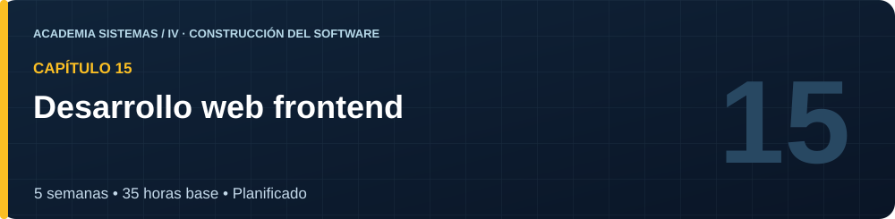

[Inicio](../../../README.md) · [Capítulo 15](../README.md)

# 📖 Clases y lecturas

> Desarrollo web frontend

> [!NOTE]
> Material planificado, todavía no desarrollado. Se incorporará al avanzar en el programa.

## Temario previsto

- HTML
- CSS
- JavaScript
- DOM
- accesibilidad
- consumo de API y framework frontend

[Plantilla de clase](../../../plantillas/clase.md).

---

[← Volver al capítulo](../README.md)
