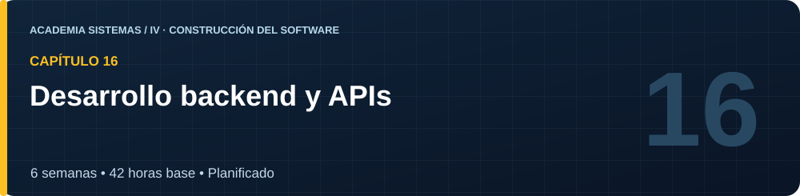

[Inicio](../../README.md) · [Pensum](../../PENSUM.md)

# Capítulo 16 · Desarrollo backend y APIs

> Este capítulo forma parte de la ruta progresiva; sus materiales completos están planificados.

**6 semanas · 42 horas base · Planificado**

## Qué vas a aprender

- Java y Spring Boot
- REST
- validación
- JPA
- transacciones
- errores y pruebas de integración

## Biblioteca del capítulo

| Sección | Contenido |
|---|---|
| [📖 Clases](clases/README.md) | Lecturas, presentaciones y actividades |
| [🧪 Laboratorios](laboratorios/README.md) | Experimentos y guías de práctica |
| [📝 Pruebas](pruebas/README.md) | Evaluaciones y criterios |
| [🛠️ Proyecto](proyecto/README.md) | Aplicación integradora |

## Proyecto de cierre

**API REST con PostgreSQL**

La guía detallada está pendiente de desarrollo.

---

[← Capítulo 15](../15-frontend/README.md) · [Índice general](../../README.md) · [Capítulo 17 →](../17-arquitectura-software/README.md)
