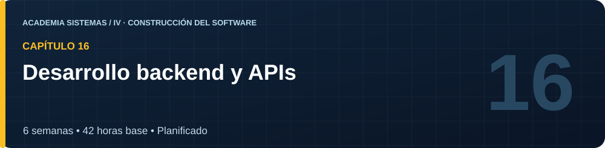

[Inicio](../../../README.md) · [Capítulo 16](../README.md)

# 📖 Clases y lecturas

> Desarrollo backend y APIs

> [!NOTE]
> Material planificado, todavía no desarrollado. Se incorporará al avanzar en el programa.

## Temario previsto

- Java y Spring Boot
- REST
- validación
- JPA
- transacciones
- errores y pruebas de integración

[Plantilla de clase](../../../plantillas/clase.md).

---

[← Volver al capítulo](../README.md)
