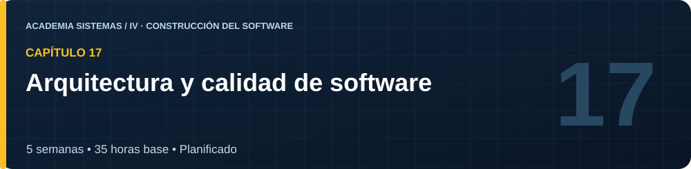

[Inicio](../../../README.md) · [Capítulo 17](../README.md)

# 📖 Clases y lecturas

> Arquitectura y calidad de software

> [!NOTE]
> Material planificado, todavía no desarrollado. Se incorporará al avanzar en el programa.

## Temario previsto

- SOLID
- patrones
- arquitectura por capas
- modularidad
- refactorización
- pruebas y documentación

[Plantilla de clase](../../../plantillas/clase.md).

---

[← Volver al capítulo](../README.md)
