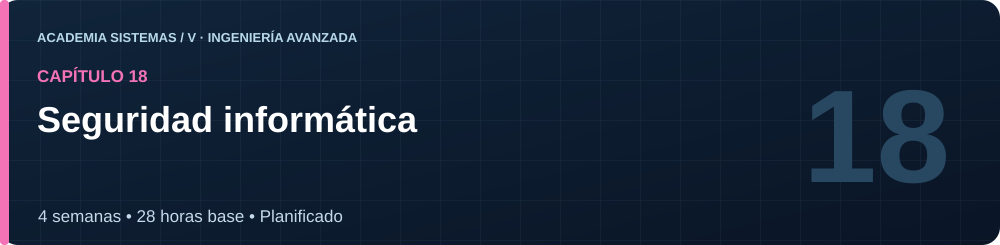

[Inicio](../../../README.md) · [Capítulo 18](../README.md)

# 📖 Clases y lecturas

> Seguridad informática

> [!NOTE]
> Material planificado, todavía no desarrollado. Se incorporará al avanzar en el programa.

## Temario previsto

- Modelado de amenazas
- autenticación
- autorización
- criptografía básica y desarrollo seguro

[Plantilla de clase](../../../plantillas/clase.md).

---

[← Volver al capítulo](../README.md)
