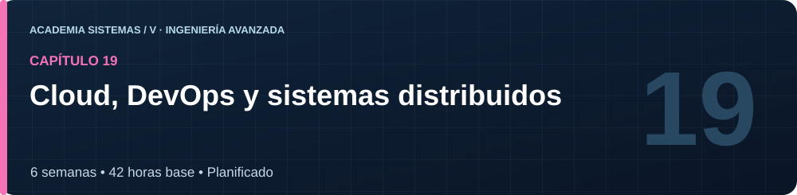

[Inicio](../../README.md) · [Pensum](../../PENSUM.md)

# Capítulo 19 · Cloud, DevOps y sistemas distribuidos

> Este capítulo forma parte de la ruta progresiva; sus materiales completos están planificados.

**6 semanas · 42 horas base · Planificado**

## Qué vas a aprender

- Docker
- CI/CD
- Linux servidor
- observabilidad
- escalabilidad
- mensajería y consistencia

## Biblioteca del capítulo

| Sección | Contenido |
|---|---|
| [📖 Clases](clases/README.md) | Lecturas, presentaciones y actividades |
| [🧪 Laboratorios](laboratorios/README.md) | Experimentos y guías de práctica |
| [📝 Pruebas](pruebas/README.md) | Evaluaciones y criterios |
| [🛠️ Proyecto](proyecto/README.md) | Aplicación integradora |

## Proyecto de cierre

**Desplegar un sistema con contenedores**

La guía detallada está pendiente de desarrollo.

---

[← Capítulo 18](../18-seguridad-informatica/README.md) · [Índice general](../../README.md) · [Capítulo 20 →](../20-inteligencia-artificial/README.md)
