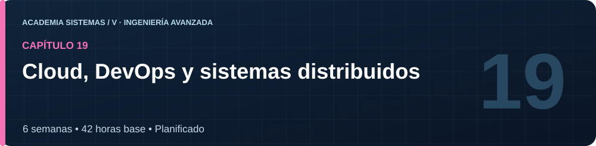

[Inicio](../../../README.md) · [Capítulo 19](../README.md)

# 📖 Clases y lecturas

> Cloud, DevOps y sistemas distribuidos

> [!NOTE]
> Material planificado, todavía no desarrollado. Se incorporará al avanzar en el programa.

## Temario previsto

- Docker
- CI/CD
- Linux servidor
- observabilidad
- escalabilidad
- mensajería y consistencia

[Plantilla de clase](../../../plantillas/clase.md).

---

[← Volver al capítulo](../README.md)
