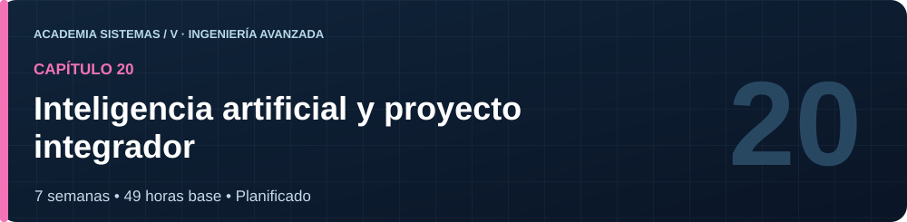

[Inicio](../../README.md) · [Pensum](../../PENSUM.md)

# Capítulo 20 · Inteligencia artificial y proyecto integrador

> Este capítulo forma parte de la ruta progresiva; sus materiales completos están planificados.

**7 semanas · 49 horas base · Planificado**

## Qué vas a aprender

- Datos
- estadística
- aprendizaje automático
- evaluación
- ética y proyecto final

## Biblioteca del capítulo

| Sección | Contenido |
|---|---|
| [📖 Clases](clases/README.md) | Lecturas, presentaciones y actividades |
| [🧪 Laboratorios](laboratorios/README.md) | Experimentos y guías de práctica |
| [📝 Pruebas](pruebas/README.md) | Evaluaciones y criterios |
| [🛠️ Proyecto](proyecto/README.md) | Aplicación integradora |

## Proyecto de cierre

**Estación de monitoreo con dispositivo, API, BD e interfaz**

La guía detallada está pendiente de desarrollo.

---

[← Capítulo 19](../19-cloud-devops/README.md) · [Índice general](../../README.md) · [Índice →](../../README.md)
