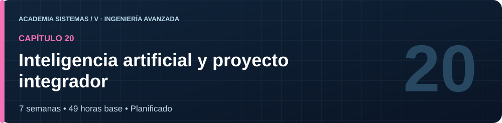

[Inicio](../../../README.md) · [Capítulo 20](../README.md)

# 📖 Clases y lecturas

> Inteligencia artificial y proyecto integrador

> [!NOTE]
> Material planificado, todavía no desarrollado. Se incorporará al avanzar en el programa.

## Temario previsto

- Datos
- estadística
- aprendizaje automático
- evaluación
- ética y proyecto final

[Plantilla de clase](../../../plantillas/clase.md).

---

[← Volver al capítulo](../README.md)
