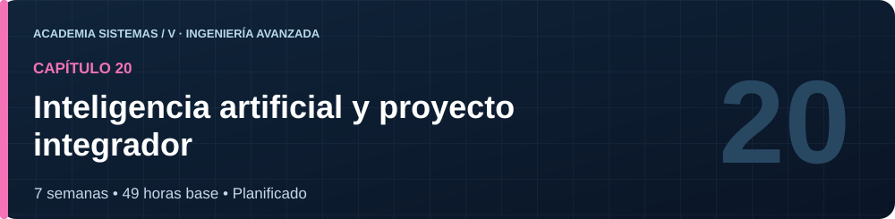

[Inicio](../../../README.md) · [Capítulo 20](../README.md)

# 🛠️ Proyecto integrador

> Inteligencia artificial y proyecto integrador

> [!NOTE]
> Material planificado, todavía no desarrollado. Se incorporará al avanzar en el programa.

## Reto previsto

Estación de monitoreo con dispositivo, API, BD e interfaz.

[Ver rúbrica general](../../../plantillas/rubrica-proyecto.md).

---

[← Volver al capítulo](../README.md)
