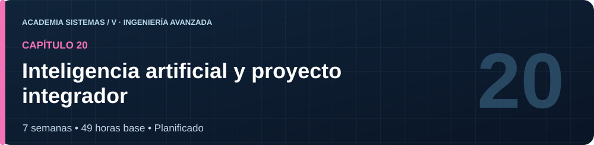

[Inicio](../../../README.md) · [Capítulo 20](../README.md)

# 📝 Evaluaciones

> Inteligencia artificial y proyecto integrador

> [!NOTE]
> Material planificado, todavía no desarrollado. Se incorporará al avanzar en el programa.

Cada prueba tendrá instrucciones, puntuación, criterios y solucionario separado.

---

[← Volver al capítulo](../README.md)
