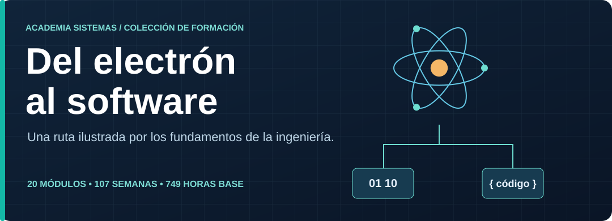

[Inicio](../README.md) · [Pensum](../PENSUM.md)

# Informe de laboratorio
Fecha:
Objetivo:
Materiales:
Hipótesis:
Procedimiento:
Resultados (tabla, unidades y evidencias):
Análisis:
Errores y limitaciones:
Conclusión:

No publicar datos personales en el repositorio.

---

ACADEMIA SISTEMAS · [Índice general](../README.md)
